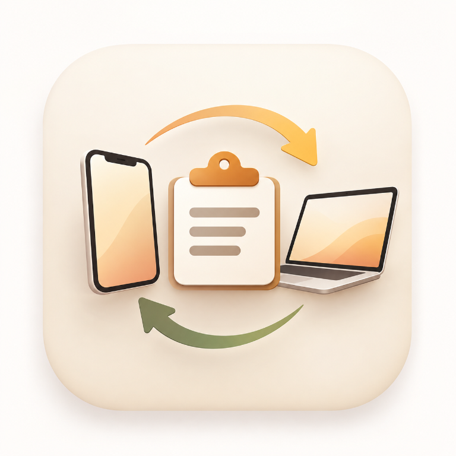

# ClipBridge



Secure, local-network clipboard synchronization between a Windows PC and an
Android phone. ClipBridge does not use a cloud relay: text and URLs travel
directly between paired devices over your local Wi-Fi network.

ClipBridge is currently distributed as a private sideload. It is not an
official Microsoft Store or Google Play release.

## Features

- Two-way text and URL clipboard synchronization.
- Windows tray application with background clipboard monitoring.
- Android foreground sync service.
- One-time QR-code pairing.
- Pinned TLS transport and HMAC-authenticated messages.
- Local-only device discovery with mDNS.
- Durable local history with search, pin, restore, and delete.
- Pause/resume synchronization.
- Device revocation and identity reset.
- Windows startup option.
- No clipboard payloads in application logs.

Images, files, HTML, and streamed transfers are not implemented yet. Their
protocol fields are reserved and currently report `unsupported`.

## Requirements

### Windows

- Windows 10 or Windows 11.
- A Private network profile for the Wi-Fi connection.
- Administrator access only if Windows Firewall asks for a rule.

### Android

- Android 8.0 (API 26) or newer.
- Both devices on the same Wi-Fi network.

End users do not need Python, Android Studio, the Android SDK, Java, Gradle,
or ADB. Those tools are only needed to build ClipBridge from source.

## Run on Windows from source

Open PowerShell:

```powershell
cd D:\ClipBridge
Set-ExecutionPolicy -Scope Process -ExecutionPolicy Bypass
.\scripts\setup.ps1
```

The setup script creates `windows-agent\.venv` and installs the Windows
dependencies. It only needs to be run once, or again after dependencies
change.

Open a separate **Administrator PowerShell** for the firewall rule:

```powershell
cd D:\ClipBridge
Set-ExecutionPolicy -Scope Process -ExecutionPolicy Bypass
.\scripts\firewall.ps1
```

Then start the Windows agent from a normal PowerShell:

```powershell
cd D:\ClipBridge
Set-ExecutionPolicy -Scope Process -ExecutionPolicy Bypass
.\scripts\run.ps1
```

Keep this PowerShell window open while the agent is running. Press `Ctrl+C` to
stop it. The ClipBridge tray icon appears near the Windows clock.

## React Native Windows dashboard

The polished Windows dashboard is in [`ClipBridgeWindows`](ClipBridgeWindows).
The Python process remains the background sync and tray service; the dashboard
controls it through a loopback-only API on port `48501`.

To run the dashboard during development, keep the Python agent running in one
PowerShell window, then use another PowerShell window with the required
Visual Studio Windows/UWP workload:

```powershell
cd D:\ClipBridge\ClipBridgeWindows
npm install
npm run windows
```

The dashboard supports connection status, pairing, pause/resume, and device
disconnect. The portable release EXE still includes the tray service and its
fallback pairing window; packaging the React Native dashboard as a separate
signed Windows app is a developer build step until a Windows installer is
added.

## Browser dashboard and Tkinter windows

The portable Windows build provides both interfaces:

- A browser dashboard opens automatically at
  `http://127.0.0.1:48501/dashboard`.
- The native Tkinter pairing and history windows remain available from the
  tray menu.
- Use **Open web dashboard**, **Pair new phone**, or **History** in the tray
  menu to open either interface.

The browser dashboard only listens on localhost and is not exposed to other
devices on the network.

## Run Android without Android Studio

This section is for developers building the project from source. If you only
want to use ClipBridge, download the APK from a release and follow
[Private distribution](#private-distribution).

Set the command-line tool paths for the current PowerShell session. Replace
the paths if your installations are different:

```powershell
$env:JAVA_HOME = "C:\Program Files\Eclipse Adoptium\jdk-17.0.18.8-hotspot"
$env:Path = "$env:JAVA_HOME\bin;$env:Path"
$env:ANDROID_HOME = "D:\locals"
$env:ANDROID_SDK_ROOT = $env:ANDROID_HOME
$env:Path = "$env:ANDROID_HOME\platform-tools;$env:Path"
```

`JAVA_HOME` must point to the JDK folder, not the `bin` folder.

Enable Developer options and USB debugging on the phone, connect it by USB,
and accept the Android RSA prompt. Confirm that it is authorized:

```powershell
adb devices
```

Generate the Gradle wrapper once:

```powershell
cd D:\ClipBridge\android-app
gradle wrapper
```

Build, install, and launch the app:

```powershell
cd D:\ClipBridge
.\scripts\run-android.ps1
```

To build without installing:

```powershell
.\scripts\run-android.ps1 -BuildOnly
```

If the phone displays `unauthorized`, unlock it and accept the USB debugging
prompt. Disable battery optimization for ClipBridge so the foreground service
can maintain the connection.

## Pair the devices

1. Start ClipBridge on Windows.
2. Right-click the Windows tray icon and choose **Pair new phone**.
3. Open ClipBridge on Android and tap **Pair phone**.
4. Scan the QR code shown by Windows.
5. Confirm the pairing prompt on Windows.
6. Copy a short text on either device and verify that it arrives on the other.

The QR token is single-use and expires after five minutes. Pairing should only
be confirmed when you personally initiated the scan.

## Private distribution

Build a Windows executable and Android APK with:

```powershell
cd D:\ClipBridge
Set-ExecutionPolicy -Scope Process -ExecutionPolicy Bypass
.\scripts\package-release.ps1
```

If PowerShell blocks `.ps1` files on your machine, use the wrapper instead:

```powershell
.\scripts\package-release.cmd
```

The script creates:

```text
release\ClipBridge-Windows.exe
release\ClipBridge-Android.apk
release\INSTALL.txt
```

Windows users can copy the EXE anywhere and run it directly; Python is not
required. Android users can copy the APK to their phone, open it, allow
**Install unknown apps** for the app that opened the file, and then launch
ClipBridge. No USB cable, Android Studio, SDK, or ADB is required.

The APK produced by this private distribution script is signed with Gradle's
debug key so it is directly installable. Keep the same signing key when
shipping updates to the same users. For a public production release, configure
a private release keystore instead of sharing a debug-signed APK.

To also create a convenient ZIP containing the EXE, APK, and installation
instructions:

```powershell
.\scripts\package-release.ps1 -CreateZip
```

The generated `release` folder is intentionally ignored by Git.

To build only one platform:

```powershell
.\scripts\package-release.ps1 -SkipAndroid
.\scripts\package-release.ps1 -SkipWindows
```

The Windows EXE is not code-signed, so Windows SmartScreen may display a
warning. Verify the file source before allowing it.

## Maintenance and recovery commands

Reset Windows identity and remove all paired devices:

```powershell
cd D:\ClipBridge
.\windows-agent\.venv\Scripts\python.exe -m clipbridge --reset-identity
```

This requires pairing every phone again.

Remove the Windows firewall rules:

```powershell
cd D:\ClipBridge
.\scripts\firewall.ps1 -Remove
```

Windows data is stored under `%APPDATA%\ClipBridge`, including the encrypted
identity/device data, history database, and log file. The log does not contain
clipboard payloads. Unpairing or uninstalling does not automatically delete
this directory; remove it manually only after stopping ClipBridge if you want
to erase local data.

## Testing

Run the Windows tests from the project root:

```powershell
cd D:\ClipBridge
.\windows-agent\.venv\Scripts\python.exe -m pytest tests
```

The manual end-to-end checklist is in [`docs/TESTING.md`](docs/TESTING.md).
Protocol and security details are in
[`docs/PROTOCOL_AND_SECURITY.md`](docs/PROTOCOL_AND_SECURITY.md).

## Project layout

```text
android-app\       Android client and foreground service
branding\          Shared application artwork and Windows icon
docs\              Testing, protocol, architecture, and threat model docs
scripts\           Setup, run, firewall, build, and packaging scripts
shared\            Shared schemas
tests\             Windows and protocol tests
windows-agent\     Windows tray agent and sync engine
ClipBridgeWindows\ React Native for Windows dashboard
```

## License

ClipBridge is available under the
[ClipBridge Non-Commercial License](LICENSE). Personal, educational, research,
and genuinely non-commercial use is permitted. Commercial use, resale,
commercial redistribution, paid services, and inclusion in a commercial
product require separate written permission.

Third-party dependencies and Android libraries remain under their own licenses.
See their package metadata and upstream license files for details.
